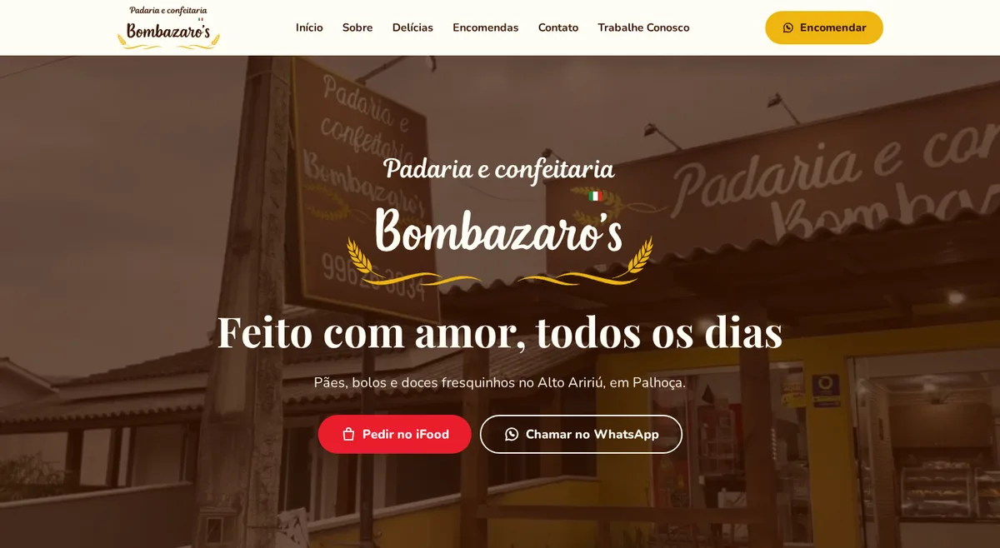

# Padaria e Confeitaria Bombazaro's

Site da padaria e confeitaria da minha família, no Alto Aririú, em Palhoça/SC. Meus tios atualizam
produtos, avisos, horários e fotos sozinhos, por um painel em português, sem precisar de programador.

**🌐 [padariabombazaros.netlify.app](https://padariabombazaros.netlify.app)**

<p align="center">
  
  &nbsp;
  
</p>

## Destaques

- **Painel de conteúdo para quem não é da área** — [Sanity Studio](https://www.sanity.io) traduzido, com
  campos explicados, validação ("Precisa ser depois de 12:00"), avisos que somem sozinhos numa data e
  produtos que podem ser escondidos sem apagar.
- **"Aberto agora" calculado no fuso de Brasília**, independente do fuso de quem visita, com suporte a
  intervalo no meio do dia (`src/lib/horario.ts`, coberto por testes).
- **Trabalhe Conosco com envio de currículo** pelo Netlify Forms, sem back-end: validação de arquivo,
  telefone e e-mail, honeypot contra spam e foco no primeiro erro.
- **Identidade visual a partir da logo** — logos vetorizadas por camada de cor (potrace), paleta com
  contraste WCAG conferido e ícone feito com o "B" da própria logo.
- **Acessibilidade** — link "pular para o conteúdo", menu com `aria-expanded` e Esc, `<dialog>` na galeria,
  vídeo desligado com `prefers-reduced-motion` ou economia de dados.
- **SEO local** — Open Graph para o preview no WhatsApp e JSON-LD `Bakery` com endereço e coordenadas.
- **Nunca publica dado inventado** — sem o painel configurado, usa conteúdo de exemplo; avisos, horários e
  equipe de exemplo só aparecem em desenvolvimento.
- **Custo zero** — Netlify (site e formulário) e Sanity (painel e imagens) nos planos gratuitos.

## Stack

React 19 · TypeScript · Vite · Tailwind CSS v4 · React Router · TanStack Query · Embla Carousel ·
Sanity (GROQ) · Netlify Forms · Vitest · oxlint · Prettier

O plano completo, com as decisões, os wireframes e o passo a passo, está em [`plano.md`](plano.md).

## Rodando no computador

```bash
npm install
npm run dev        # site em http://localhost:5173
npm test           # testes (horários, WhatsApp, validação do formulário)
npm run lint
npm run build      # gera a pasta dist/
```

Sem o Sanity configurado, o site usa os **dados de exemplo** de `src/data/exemplo.ts`.
Aviso, data especial, equipe e horários de exemplo só aparecem com `npm run dev` — nunca no site publicado.

## Configurando o painel (Sanity) — uma vez só

1. Crie uma conta em https://www.sanity.io (pode entrar com Google ou GitHub).
2. No terminal:
   ```bash
   cd studio
   npm install
   npx sanity login
   npx sanity init --env .env --project-name "Bombazaros" --dataset production
   ```
   Isso cria o projeto e um `studio/.env` com o `SANITY_STUDIO_PROJECT_ID`.
3. Copie `.env.example` para `.env` na raiz e coloque o mesmo ID em `VITE_SANITY_PROJECT_ID`.
4. Em https://www.sanity.io/manage → seu projeto → **API → CORS origins**, adicione
   `http://localhost:5173` e o endereço do Netlify (sem "Allow credentials").
5. Rode o painel: `npm run painel` (http://localhost:3333). Cadastre os produtos e as informações da loja.
6. Publique o painel: `cd studio && npm run deploy` → https://bombazaros.sanity.studio
7. Em **Members**, convide os tios pelo e-mail Google deles (papel *Editor*).

## Publicando no Netlify

Siga a Fase 11 do `plano.md`. Resumo: importar o repositório no Netlify, adicionar as variáveis
`VITE_SANITY_PROJECT_ID` e `VITE_SANITY_DATASET`, e ativar **Forms → Form notifications** para o
e-mail `padariabombazaros@gmail.com`. Depois disso, todo `git push` na `main` publica o site.

## Onde mexer

| Quero mudar... | Arquivo |
|---|---|
| Telefone, links, CNPJ, mapa | `src/data/info.ts` |
| Cores e fontes | `src/index.css` (bloco `@theme`) |
| Texto da história (Sobre) | `src/components/sections/Sobre.tsx` |
| Campos do painel | `studio/schemaTypes/` (e os tipos em `src/types/conteudo.ts`) |
| Ordem das seções | `src/pages/Inicio.tsx` |

## Licença

O **código** está sob a [licença MIT](LICENSE). O **nome, a logo, as fotos, os vídeos e os textos** da
Padaria e Confeitaria Bombazaro's não fazem parte da licença: todos os direitos são reservados e eles não
podem ser reutilizados sem autorização.
